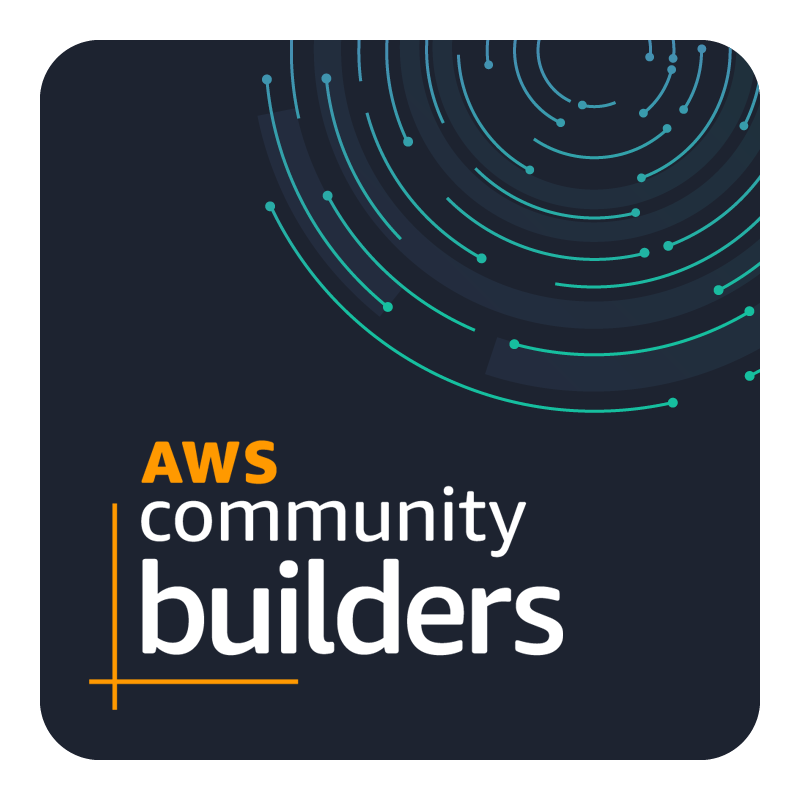

<table>
<tr>
<td align="center" width="80">

</td>
<td align="left">
<h4>Hi, I'm Ho Dang Thai Duy — Aspiring AI Engineer</h4>
</td>
</tr>
<tr>
<td align="center" width="80">

</td>
<td align="left">
<h4>Challenger — <b>AWS Student Builder Group HCMUTE</b></h4>
</td>
</tr>
<tr>
<td align="center" width="80">

</td>
<td align="left">
<h4>Member — <b>HCMUTE Research on Technology and Innovation Club</b></h4>
</td>
</tr>
<tr>
<td colspan="2" align="center">
<h4><i>Striving to craft high-value products, empower people, and contribute to the community</i></h4>
</td>
</tr>
</table>

